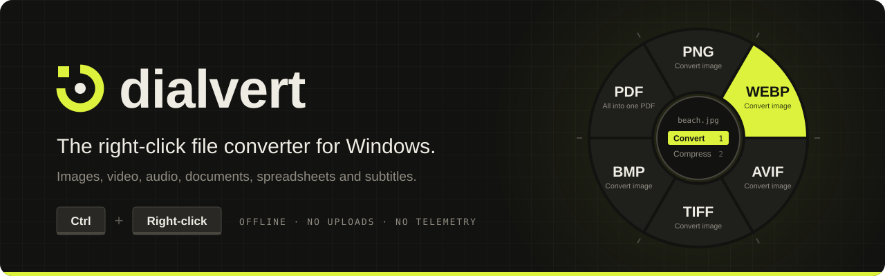
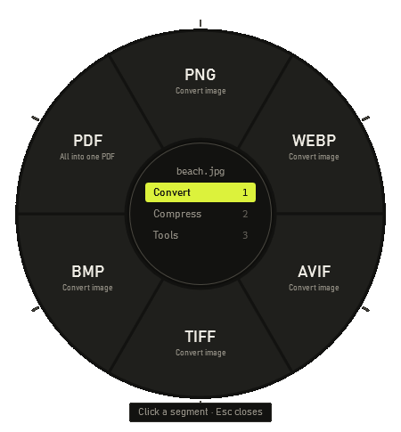
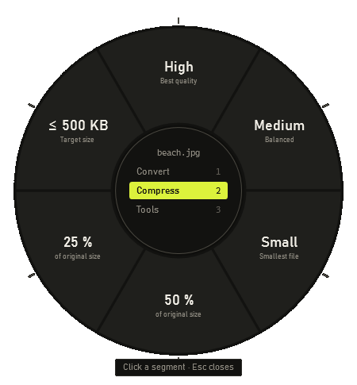
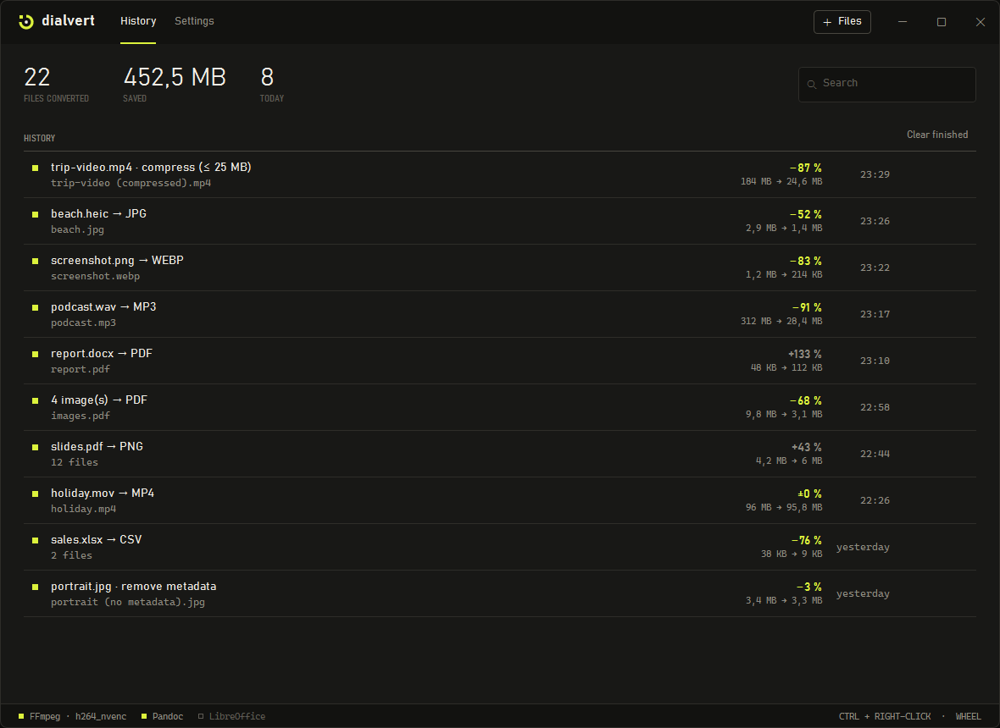
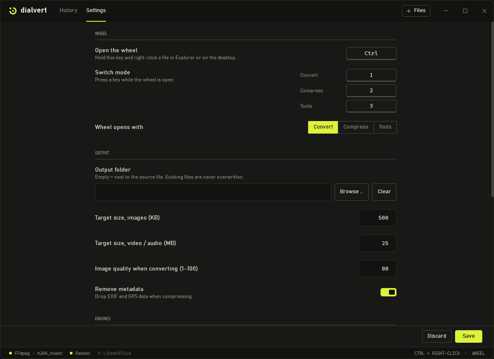

<p align="center">
  
</p>

<p align="center">
  
  
  <a href="LICENSE"></a>
  <a href="https://github.com/niklas1andonly/dialvert/actions/workflows/build.yml"></a>
</p>

<p align="center">
  <b>Hold <kbd>Ctrl</kbd>, right-click a file, pick a target. Done.</b><br>
  Dialvert converts and compresses images, video, audio, documents, spreadsheets and subtitles –<br>
  entirely on your PC. No uploads, no accounts, no telemetry.
</p>

<p align="center">
  <a href="#how-it-works">How it works</a> ·
  <a href="#what-it-can-do">What it can do</a> ·
  <a href="#getting-dialvert">Getting Dialvert</a> ·
  <a href="#building-from-source">Building</a> ·
  <a href="#inspiration">Inspiration</a>
</p>

<br>

<table align="center">
  <tr>
    <td align="center"></td>
    <td align="center"></td>
  </tr>
  <tr>
    <td align="center"><sub><b>Convert</b> · targets that make sense for the file</sub></td>
    <td align="center"><sub><b>Compress</b> · presets, percentage or a target size</sub></td>
  </tr>
</table>

## How it works

1. **Hold <kbd>Ctrl</kbd> and right-click** a file in Explorer or on the desktop. Instead of the context menu,
   the action wheel opens right under the cursor.
2. **Pick a mode** with a key – <kbd>1</kbd> Convert, <kbd>2</kbd> Compress, <kbd>3</kbd> Tools.
3. **Release over a segment** (or click it). The result lands next to the original as
   `photo (compressed).jpg` – nothing is ever overwritten.

If several files are selected and you right-click one of them, the whole selection is processed, just like
the normal context menu. A small notification in the corner shows progress and when it's done.

| Shortcut | What it does |
|---|---|
| <kbd>Ctrl</kbd> + right-click | Open the wheel on a file in Explorer or on the desktop |
| <kbd>1</kbd> <kbd>2</kbd> <kbd>3</kbd> | Switch between Convert, Compress and Tools while the wheel is open |
| <kbd>Esc</kbd> | Close the wheel |
| <kbd>Ctrl</kbd> + <kbd>Alt</kbd> + <kbd>U</kbd> | Show or hide the optional floating drop zone |

Every key can be changed in the settings. Don't like gestures? Drag files into the window, click **Files**,
use **Send to** (put a shortcut into `shell:sendto`) or run `Dialvert.exe file1 file2`.

## What it can do

| | Convert | Compress & tools | Powered by |
|---|---|---|---|
| **Images** | JPG · PNG · WebP · AVIF · TIFF · BMP, HEIC input, several images → one PDF | High / Medium / Small, 50 % / 25 %, target size · remove EXIF/GPS · halve size · longest edge 1920 px | Magick.NET |
| **Video** | MP4 · MOV · MKV · WebM · AVI · GIF, audio only → MP3 | Presets, percentage or target size (bitrate is calculated) · extract audio losslessly | FFmpeg |
| **Audio** | MP3 · M4A · WAV · FLAC · OGG · Opus | Presets, percentage or target size | FFmpeg |
| **Documents** | PDF → JPG/PNG per page, TXT, Markdown · DOCX ↔ MD ↔ TXT ↔ EPUB · Office & slides → PDF · PDF → DOCX | | PDFium, Pandoc, LibreOffice* |
| **Spreadsheets** | XLSX ↔ CSV/TSV (one file per sheet, Excel-ready dialect) · XLS/ODS ↔ XLSX · → PDF | | ClosedXML, LibreOffice* |
| **Subtitles** | SRT ↔ VTT | | built in |
| **Any file** | | Copy path · show in Explorer · open a terminal here | |

<sub>* LibreOffice is not bundled. If it is installed, Dialvert finds and uses it; otherwise those segments are
dimmed and tell you what's missing.</sub>

Video is encoded on the graphics card when possible (NVENC, Quick Sync, AMF) and falls back to Media Foundation
or OpenH264. Remuxing between containers happens without re-encoding whenever the codecs allow it.

### The window

Click the tray icon to see everything you've converted – searchable, with the space you saved – and the settings.

<p align="center">
  
</p>

<details>
<summary><b>Settings</b></summary>
<br>
<p align="center">
  
</p>
</details>

## Getting Dialvert

> [!NOTE]
> There is no prebuilt download yet. Building it takes three commands – see below.

Dialvert is portable: the published folder runs from anywhere, no installer needed. On first start it sits in the
notification area and starts with Windows (both can be turned off in the settings).

## Building from source

You need Windows 10/11 and the [.NET 10 SDK](https://dotnet.microsoft.com/download).

```powershell
# 1. Download FFmpeg (LGPL build) and Pandoc into engines\
powershell -ExecutionPolicy Bypass -File scripts\fetch-engines.ps1

# 2. Run it
dotnet run --project src\Dialvert.App

# 3. Or build a self-contained, portable folder in dist\Dialvert\ (including all license texts)
powershell -ExecutionPolicy Bypass -File scripts\publish.ps1
```

Tests generate their own images, videos and documents:

```powershell
dotnet test tests\Dialvert.Core.Tests
```

LibreOffice tests only run when LibreOffice is installed or `DIALVERT_SOFFICE` points at its `program` folder
(an MSI extracted with `msiexec /a LibreOffice.msi TARGETDIR=…` works too); otherwise they are skipped.

<details>
<summary><b>Project layout</b></summary>

| Path | What's inside |
|---|---|
| `src/Dialvert.Core` | Engines, jobs, action catalog, settings – no UI, fully testable |
| `src/Dialvert.App` | WPF app: action wheel, mouse/keyboard hooks, shell selection, tray, history, settings |
| `tests/Dialvert.Core.Tests` | xUnit tests with synthetic media and documents |
| `tests/DragHarness` | Tiny drag source that behaves like Explorer, for testing drag & drop |
| `scripts/` | Fetch engines, publish, render the app icon |
| `docs/ARCHITECTURE.md` | Stack choice, design, engines, licensing and roadmap |

Settings live in `%APPDATA%\Dialvert\settings.json`, the history and a small log in `%LOCALAPPDATA%\Dialvert\`.

</details>

## Privacy

Everything runs locally. Dialvert makes no network requests, has no accounts and collects no telemetry.
Your files are only read by the engines on your own machine, and results are written next to the originals
(or into a folder you choose).

## Inspiration

The idea comes from [**Tangerine**](https://tangerineformac.com/), a lovely zero-click offline file converter for Mac:
start dragging a file, tap a key, drop it on a target in a wheel. Tangerine is Mac-only, so Dialvert brings the same
workflow to Windows – written from scratch.

Dialvert is an independent hobby project. It is **not affiliated with or endorsed by** the makers of Tangerine and
contains none of their code, graphics or other assets. If you're on a Mac, go check out Tangerine.

## License

Dialvert is released under the [MIT License](LICENSE).

The engines it drives are separate projects under their own licenses – FFmpeg (LGPL-2.1+), Pandoc (GPL-2.0+),
Magick.NET (Apache-2.0), PDFium (BSD-3-Clause), ClosedXML (MIT) and more. None of them are part of this repository:
NuGet packages are restored at build time and FFmpeg/Pandoc are downloaded by `scripts\fetch-engines.ps1`.
A published build ships every license text. Details: [THIRD-PARTY-NOTICES.md](THIRD-PARTY-NOTICES.md).
